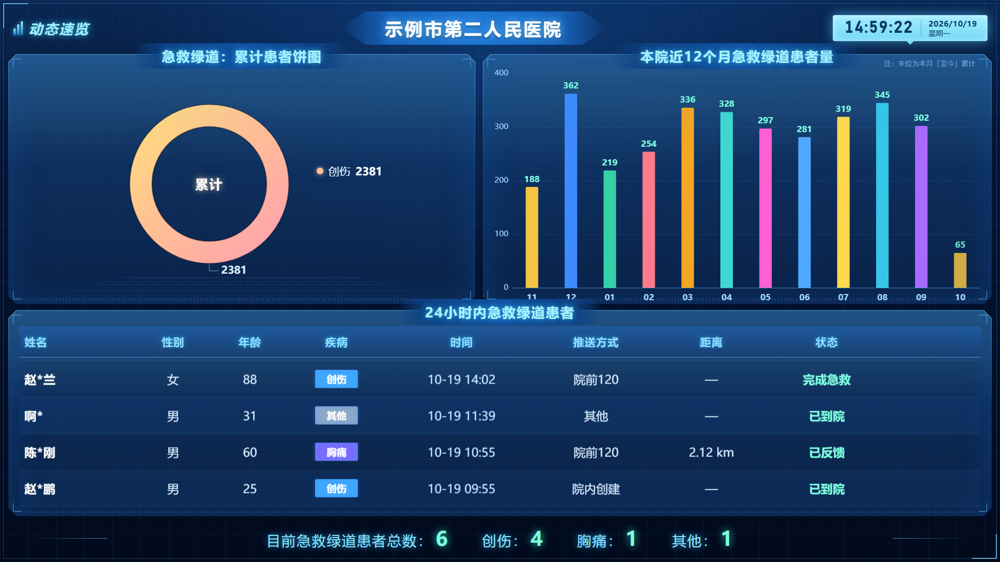
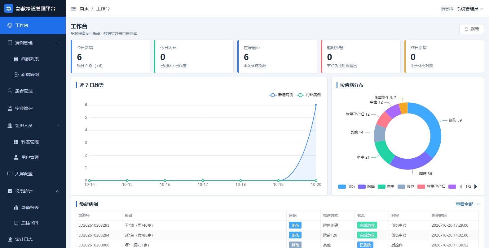

# 急诊专科中心数据平台 · 急救绿道

**急救绿道数据平台**：版面与交互 1:1 还原参考大屏，数据为合成示例数据，不代表任何真实机构的统计值。包含两个前端与一套后端：

| 端 | 说明 | 地址 |
|---|---|---|
| 大屏可视化终端 | 只读、常驻横屏，对应参考大屏的界面 | `/screen/` |
| 后台管理系统 | 病例管理、字典维护、统计报表、系统设置 | `/admin/` |
| 本地后端 | NestJS + node:sqlite，统一前缀 | `/api/v1` |
| 公网后端（可选） | Cloudflare Workers + D1，同一套接口契约 | [`apps/worker/`](apps/worker/) |



> 上图是 1920×1080 实机渲染截图，不是设计稿，画面内全部为合成演示数据。仓库只保留界面渲染截图（见 [`docs/refs/`](docs/refs/README.md)）；源素材因隐私原因不随仓库发布。

---

## 零、发布到公网（Cloudflare）与推送到 GitHub

### 推送到 GitHub

仓库已在本地初始化并完成首次提交，`node_modules` / `data` / `logs` / 现场素材均已排除。

```bash
# 方式一：已安装 gh CLI
gh repo create hospital-data-platform --public --source=. --remote=origin --push

# 方式二：先在 github.com 建好空仓库，再执行
git remote add origin https://github.com/<你的用户名>/hospital-data-platform.git
git branch -M main
git push -u origin main
```

> 首次推送需要认证：HTTPS 方式请用 **Personal Access Token** 代替密码，或先执行 `gh auth login`。

### 部署到 Cloudflare（免费额度足够）

> Cloudflare Workers 跑不了 `node:sqlite` 与 NestJS，因此 `apps/worker/` 是针对 Workers **重写的后端壳**：
> 路由、存储、口令校验换成 Workers 原语，但接口契约、SQL 与业务口径与本地版一一对应。
> 差异（导出改 CSV、附件上传未启用、无 SSE、明文查看关闭）见部署文档。

```bash
pnpm --filter @hospital/worker exec wrangler login
pnpm --filter @hospital/worker exec wrangler d1 create hospital_platform   # 把返回的 id 填进 wrangler.toml
pnpm build
node tools/export-d1-seed.mjs                  # 用现有种子逻辑生成 D1 导入 SQL
pnpm --filter @hospital/worker db:remote       # 导入线上 D1（一次性）
node apps/worker/scripts/build-assets.mjs      # 汇总两个前端产物
pnpm --filter @hospital/worker deploy          # 部署并输出公网地址
```

推送 `main` 后 GitHub Actions 会自动重新部署（需配置 `CLOUDFLARE_API_TOKEN` 与 `CLOUDFLARE_ACCOUNT_ID` 两个 secret）。
完整步骤、配额说明与故障排查见 **[docs/DEPLOY-CLOUDFLARE.md](docs/DEPLOY-CLOUDFLARE.md)**。

---

## 一、快速开始

### 方式一：双击 `启动.bat`（推荐，不需要装 pnpm）

双击项目根目录的 **`启动.bat`**，脚本会自动完成「装依赖 → 初始化数据 → 构建 → 启动 → 打开浏览器」，缺哪一步补哪一步。

它会在 PATH 上找 `pnpm`；**没装 pnpm 也没关系**——回退用 Node 自带的 `corepack pnpm`（本机已验证），再不行用 `npx pnpm@11`。服务窗口保持打开即服务在跑，关掉窗口即停止。

### 方式二：命令行

前置：Node.js ≥ 20（实测 v24）+ pnpm ≥ 10（实测 v11）。

```bash
pnpm install        # 安装依赖
pnpm db:reset       # 建库 + 导入演示数据（约 1 秒，5400+ 条病例）
pnpm build          # 构建 shared / 后端 / 两个前端
pnpm start          # 启动服务（默认 3000 端口）
```

> 如果提示 `pnpm 不是内部或外部命令`，执行一次 `corepack enable pnpm` 即可（Node 自带 corepack）。

> 📖 完整的部署与运维手册（局域网访问、开机自启、大屏 Kiosk 配置、备份升级、故障排查、上线检查清单）见 **[docs/DEPLOY.md](docs/DEPLOY.md)**。

### 启动后打开哪些地址

| 入口 | 地址 |
|---|---|
| 导航页 | <http://127.0.0.1:3000/> |
| 大屏终端 | <http://127.0.0.1:3000/screen/> |
| 管理后台 | <http://127.0.0.1:3000/admin/> |

出问题时先双击 **`诊断.bat`**：它会一次性打印运行环境、文件完整性、端口占用和最近日志（`logs/launch.log`），把输出发出来即可定位。

> ⚠️ **不要直接双击 `apps/admin-web/index.html` 或 `apps/screen-web/index.html`**，那会是一片空白。
> 它们是 Vite 的**源码模板**（只引用 `/src/main.ts`），浏览器既不执行 TypeScript，`file://` 协议下 ES 模块也会被 CORS 拦截。构建产物 `dist/index.html` 同理（资源路径是 `/admin/...` 绝对路径），**必须通过上面的 HTTP 地址访问**。

### 演示账号（口令统一为 `Hospital@123`）

| 账号 | 角色 | 能做什么 |
|---|---|---|
| `admin` | 系统管理员 | 全部权限 |
| `eradmin` | 急诊科管理员 | 病例全量管理、报表、导出、大屏配置 |
| `doctor01` | 急诊医生 | 病例录入/编辑/补录时间节点 |
| `nurse01` | 急诊护士 | 病例录入与查看（**无**审计权限，可用于验证越权拦截） |
| `qc01` | 质控员 | 全量只读 + 报表 + 审计 |
| `leader01` | 院领导 | 全院只读 + 报表（**无**患者明文权限） |
| `screen` | 大屏账号 | 仅大屏只读接口 |

---

## 二、开发模式

```bash
pnpm dev            # 后端(tsc watch) + 后台(5173) + 大屏(5174) 一起启动
pnpm dev:server     # 只启后端
pnpm dev:admin      # 只启后台（vite，代理 /api → 3000）
pnpm dev:screen     # 只启大屏
```

开发模式下前端各自带 Vite dev server；`pnpm build && pnpm start` 则是**一体化部署**，由后端直接托管两个前端产物（`/screen/`、`/admin/`），只占一个端口。

---

## 三、目录结构

```
yiyuanshujuguanlixitong/
├── apps/
│   ├── server/          后端（NestJS + node:sqlite）
│   │   ├── src/db/      建表 SQL、种子数据、SQLite 薄封装
│   │   ├── src/common/  统一响应/异常、鉴权守卫、脱敏加密、参数校验
│   │   ├── src/core/    审计服务、领域事件（SSE 信号源）
│   │   └── src/modules/ auth / dict / patient / case / screen / org / report / audit / integration
│   ├── screen-web/      大屏前端（Vue3 + ECharts，无路由单页）
│   └── admin-web/       后台前端（Vue3 + Element Plus + Pinia + hash 路由）
├── packages/shared/     前后端共享类型 / 枚举 / 错误码 / 脱敏工具（唯一类型来源）
├── tools/               验收脚本（接口验收 / 大屏验收 / 截图）
├── docs/
│   ├── PLAN.md          实现方案（SSOT）
│   ├── adr/             架构决策记录
│   └── refs/            界面渲染截图（公开）
├── data/                运行时数据（SQLite 文件、上传附件，已在 .gitignore 中）
└── tu/                  源素材（医院现场照片/录像，因隐私原因不随仓库发布）
```

代码规模：后端 43 文件 4218 行 ｜ 后台 37 文件 4272 行 ｜ 大屏 15 文件 1225 行 ｜ 共享包 5 文件 755 行 ｜ 工具 3 文件 368 行。

---

## 四、常用命令

| 命令 | 作用 |
|---|---|
| `pnpm db:init` | 只建表结构，不导数据 |
| `pnpm db:seed` | 导入演示数据（保留已有结构，清空业务表后重建） |
| `pnpm db:reset` | 删除数据库文件后重新导入（**注意：需先停掉服务**，SQLite 文件被占用时无法删除） |
| `pnpm db:refresh-demo` | 演示数据保鲜：把未闭环的示例病例对齐到今天（**非破坏性**，保留你录入的数据）；加 `--reseed` 可恢复文档基线（会清空业务表） |
| `pnpm stop` | 停止本地服务（等价于双击 `停止.bat`） |
| `pnpm autostart install\|uninstall\|status` | 管理开机自启（等价于 `开机自启.bat` / `取消开机自启.bat`） |
| `pnpm verify:bat` | 检查所有 `.bat` 是否为纯 ASCII（cmd 编码坑的回归守卫） |
| `pnpm verify` | 依次跑四套验收：批处理编码 → 接口 → 大屏 → 后台 |
| `pnpm verify:api` | 接口验收：36 项断言，把合成演示数据固化成测试 |
| `pnpm verify:screen` | 大屏验收：渲染、脱敏、无缝滚动、截图（走 Chrome DevTools 协议） |
| `pnpm verify:admin` | 后台验收：真实登录 + 10 个页面巡检 + 越权守卫 |
| `pnpm verify:patient` | 患者管理增强验收（25 项）：三个筛选、导出 CSV、批量导入、批量删除、权限 |
| `pnpm verify:case` | 病例列表增强验收（22 项）：三个筛选、导出 Excel、批量导入、批量删除、越权拦截 |
| `pnpm verify:worker` | Cloudflare 版契约验收（33 项，需先启动 worker） |
| `pnpm worker:dev` / `worker:deploy` | 本地启动 / 部署 Cloudflare Worker |
| `pnpm worker:seed` / `worker:assets` | 生成 D1 导入 SQL / 汇总前端产物 |
| `pnpm typecheck` | 全仓类型检查 |
| `pnpm shot:screen` | 单独出一张 1920×1080 大屏截图到 `docs/refs/` |
| `pnpm shot:admin` | 任意后台页面截图（注入登录态直达，用于目视核对；参数：`#/patients 输出路径 宽 高`） |

验收脚本只依赖 Node 内置能力（`fetch` / `WebSocket` / `child_process`），不需要 Playwright、Puppeteer 等额外依赖；本机装有 Chrome 或 Edge 即可运行。

---

## 五、验收结果（本机实测）

六套自动化验收全部通过，关键断言直接取自合成演示数据：

**`pnpm verify:api` → 34/34 通过（2 项因演示数据被改动自动跳过）**

| 校验项 | 结果 |
|---|---|
| 累计创伤病例数 | 2380 ✅（合成演示数据） |
| 近 12 个月柱状序列 | `188 362 219 254 336 328 297 281 319 345 302 63` ✅ 与合成数据给出值逐个一致 |
| 柱状图 y 轴上限 | 400 ✅（最大值 362 按整百向上取整） |
| 24 小时表格 | 4 行，姓名/性别/年龄/疾病/时间/推送方式/距离/状态逐字段与合成数据一致 ✅ |
| 底部统计 | 总数 4 ✅ |
| 响应体明文姓名泄漏 | 无 ✅ |
| 越权访问（护士→审计、院领导→患者明文、匿名→病例） | 全部 40300/40100 拦截 ✅ |
| 明文查看留痕 | 审计日志可查到 `VIEW_SENSITIVE` ✅ |
| 导出 | 真实 xlsx 文件流（382 KB，PK 魔数）✅ |

**`pnpm verify:screen` → 7/7 通过**，其中滚动项实测：

```
✓ 表格无缝滚动进行中 —— 位移 -104.0px / 2.6s ≈ 40.7 px/s
```

（滚动速度由后端配置下发，默认 40px/s；数据不足一屏时自动不滚动。）

**`pnpm verify:admin` → 18/18 通过**，用真实浏览器走完整登录流程并逐页巡检：

```
✓ 登录成功并跳转工作台 —— #/dashboard
✓ 工作台数值来自接口 —— 今日新增 4 / 在绿道中 4
✓ 病例列表（#/cases） —— 4        ✓ 患者管理（#/patients） —— 20
✓ 字典管理（#/dicts） —— 4        ✓ 科室管理（#/org/departments） —— 8
✓ 用户管理（#/org/users） —— 7    ✓ 大屏配置（#/screen-config）
✓ 绿道报表（#/reports/green-channel） —— 1   ✓ 质控 KPI（#/reports/kpi）
✓ 审计日志（#/audit/logs） —— 15
✓ 护士访问审计页被拦截（跳 403） —— #/403
```

后台工作台实际渲染效果（`docs/refs/admin-dashboard.png`）：



> 这套后台验收在开发过程中真实抓到一个后端 bug：病例列表按 `sort=created_at:desc` 排序时，因为 `patient` 与 `green_channel_case` 都有 `created_at`，JOIN 后列名歧义导致 500、列表空白。已修复（排序白名单改为「字段 → 带表别名表达式」映射）并补了回归断言。

---

## 六、几个关键实现说明

### 1. 业务字典全部由后端下发，前端零硬编码

疾病名称、配色、推送方式、状态、列头、表格列宽都来自数据库字典表，通过 `/screen/bootstrap` 一次性下发。
**新增一个病种只需在「字典管理」里加一行**（含颜色），大屏的饼图、柱状图配色、表格标签会自动跟随，不用改前端、不用重新发版。

### 2. 大屏聚合接口 + SSE

大屏首屏只需 1 个请求（`/screen/bootstrap`）拿整屏数据；后端对结果做 TTL 缓存（默认 5s），病例变更时通过领域事件立即失效缓存并推送 SSE 信号，前端收到信号再拉取。

选 SSE 而不是 WebSocket：大屏是纯只读终端，单向推送足够；SSE 是纯 HTTP，更容易通过医院网络设备，且浏览器原生断线重连。轮询兜底始终保留，双保险。

> SSE 长连接会让 Chrome 的 `--virtual-time-budget` 永不推进导致截图挂起，因此截图脚本用 `?stream=0` 关闭推送，实时验收脚本则保留 SSE。

### 3. 大屏适配：1920×1080 设计稿 + transform scale

按 `min(vw/1920, vh/1080)` 整体缩放并居中，任何分辨率下版面比例与设计稿严格一致、不变形，四周自动留黑边（已验证 1920×1080 出图为整屏无裁切）。

### 4. 表格无缝滚动用 CSS 动画而非 requestAnimationFrame

数据渲染两份首尾相接，动画把轨道上移「一份高度」后瞬间回位。选 CSS 动画的原因：走 GPU 合成层、主线程零开销（工控机 7×24 常驻更稳），且不依赖帧回调——窗口被遮挡或走远程桌面时依然推进。新数据到达时通过 `:key` 重建轨道，动画自动从第一条重新开始。

### 5. 脱敏在服务端完成

姓名/身份证/手机号在入库时即 AES-256-GCM 加密，同时冗余一份脱敏字段（`name_masked`）供大屏直读。**大屏接口永远不返回明文**，接口验收里有专门断言扫描整个响应体。明文查看是独立权限点（`patient:plain`）且每次调用写审计日志。

### 6. 数据库用 Node 内置 `node:sqlite`

零原生依赖、零引擎下载，内网/离线环境一定能装起来。所有 SQL 都是标准语法并集中管理，生产切 MySQL 的边界见 [`docs/adr/001`](docs/adr/001-sqlite-instead-of-prisma.md)。

---

## 七、数据口径说明（公开版）

公开版使用**合成演示数据**：版面与交互 1:1 还原参考大屏，数据为合成示例数据，不代表任何真实机构的统计值。两处口径按下列方式处理，并在此显式说明：

| 元素 | 口径 | 示例输出 |
|---|---|---|
| 底部统计条 | 当前未闭环病例按病种分组 | `总数：4  创伤：3  胸痛：1` |
| 累计饼图 | 默认按病种聚焦（`screen_config.pie_disease_code`，默认 `TRAUMA`）；清空该字段即切换为「全部疾病」的多色饼图 | 单色环 + 引线标数值 |

两个数值口径互不冲突：饼图可配置为聚焦单一病种，底部统计的分病种拆分则直接反映当前未闭环病例的构成，均可由配置驱动、无需改代码。

详见 [`docs/adr/002`](docs/adr/002-screen-data-caliber.md)。

---

## 八、生产部署注意事项

| 项 | 当前（演示） | 生产建议 |
|---|---|---|
| 数据库 | SQLite 单文件 | MySQL 8 / 信创库（改 `db/sqlite.ts` + `db/schema.ts`，见 ADR-001） |
| 密钥 | 代码内默认值 | `JWT_SECRET` / `CRYPTO_KEY` 必须通过环境变量或配置中心注入 |
| 大屏访问 | `DEMO_MODE=true` 允许匿名只读 | 置 `DEMO_MODE=false`，大屏需用 `screen` 账号令牌（`/screen/?token=xxx`） |
| 加密算法 | AES-256-GCM | 若要求国密，替换 `common/crypto.ts` 为 SM4/SM3 |
| 部署形态 | 单进程 + SQLite | 多实例时：验证码/登录锁定等内存态迁移到 Redis，SSE 需要广播通道 |
| 大屏终端 | 浏览器打开 `/screen/` | Chrome Kiosk：`--kiosk --incognito --disable-pinch`，关闭系统休眠与屏保，配置开机自启 |
| 字体 | 系统字体栈 | 内网无外网，字体已全部本地化（无任何 CDN 依赖）；如需指定字体，把字体文件放进 `apps/screen-web/src/assets` 并改 `--font-cn` |

环境变量清单见 `apps/server/src/config.ts`，全部有默认值，可按需覆盖。
